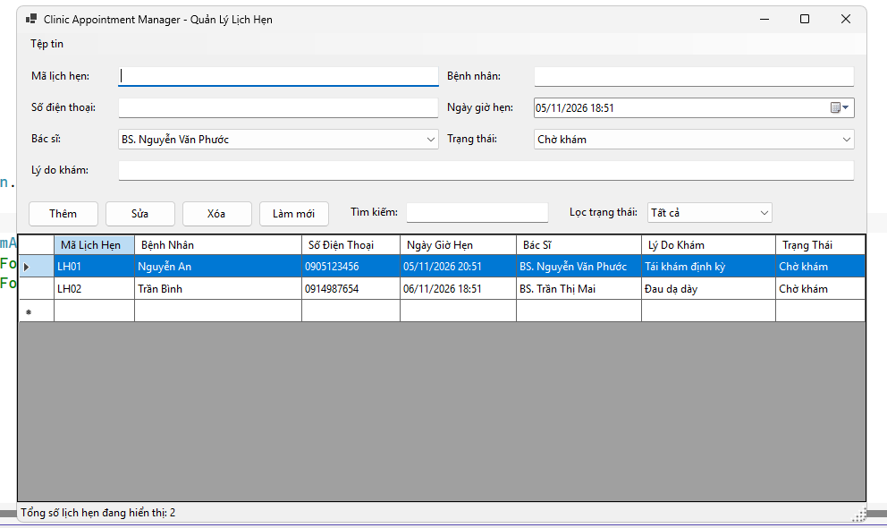
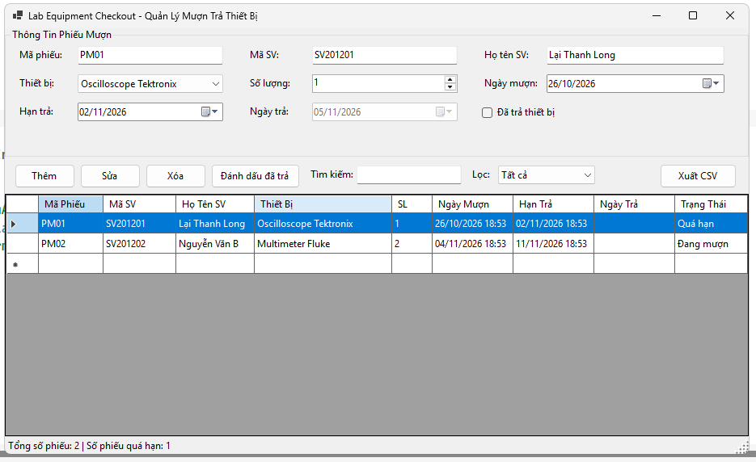
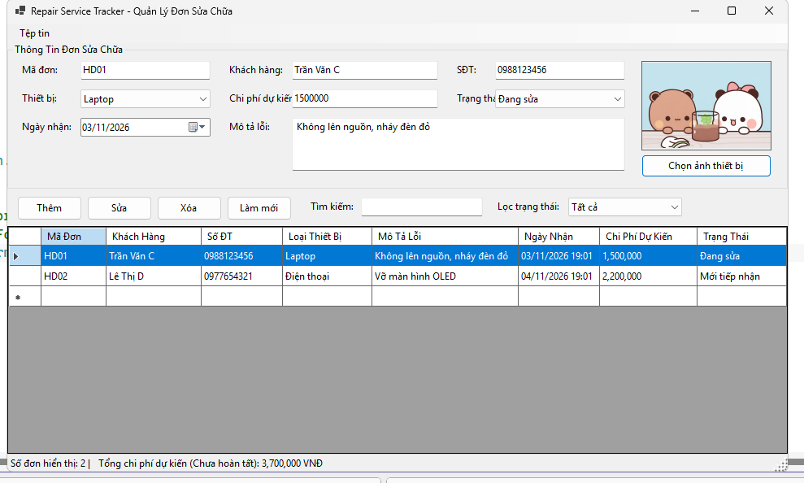

# BÁO CÁO BÀI TẬP LẬP TRÌNH C# - WINDOWS FORMS

## THÔNG TIN SINH VIÊN

- **Họ và tên:** Lại Thanh Long
- **Mã số sinh viên:** 24810310231
- **Lớp:** D19CNPM3
- **Tên môn học:** Lập trình C# / Windows Forms
- **Tên bài tập:** Báo cáo trọn bộ 3 bài tập Windows Forms (`Bai_tap_WindowsForms`)

---

## KẾT QUẢ THỰC HÀNH CÁC BÀI TẬP

### 1. Bài 1: Quản lý lịch hẹn phòng khám (Clinic Appointment Manager)

- Sử dụng `TableLayoutPanel` thiết kế giao diện co giãn responsive.
- Định dạng ngày giờ hẹn qua `DateTimePicker`, quản lý danh sách bằng `BindingSource` và `BindingList<T>`.
- Kiểm tra dữ liệu bắt buộc (SĐT, Ngày hẹn không thuộc quá khứ) hiển thị báo lỗi bằng `ErrorProvider`.

---

### 2. Bài 2: Quản lý mượn trả thiết bị (Lab Equipment Checkout)

- Quản lý phiếu mượn thiết bị phòng thực hành, tự động nhận diện trạng thái **Quá hạn** khi đến hạn trả.
- Tích hợp tính năng đánh dấu đã trả thiết bị, cập nhật ngày trả thực tế lên `DataGridView`.
- Lọc danh sách theo trạng thái và hiển thị tổng số phiếu/số phiếu quá hạn trên `StatusStrip`.

---

### 3. Bài 3: Quản lý đơn đăng ký dịch vụ sửa chữa (Repair Service Tracker)

- Quản lý đơn sửa chữa thiết bị, định dạng chi phí dự kiến dạng tiền tệ (`N0`).
- Tích hợp `PictureBox` (chế độ `Zoom`) hiển thị ảnh chụp thiết bị bằng `OpenFileDialog`.
- Tính tổng chi phí dự kiến của các đơn chưa hoàn tất hiển thị trực tiếp trên thanh `StatusStrip`.

